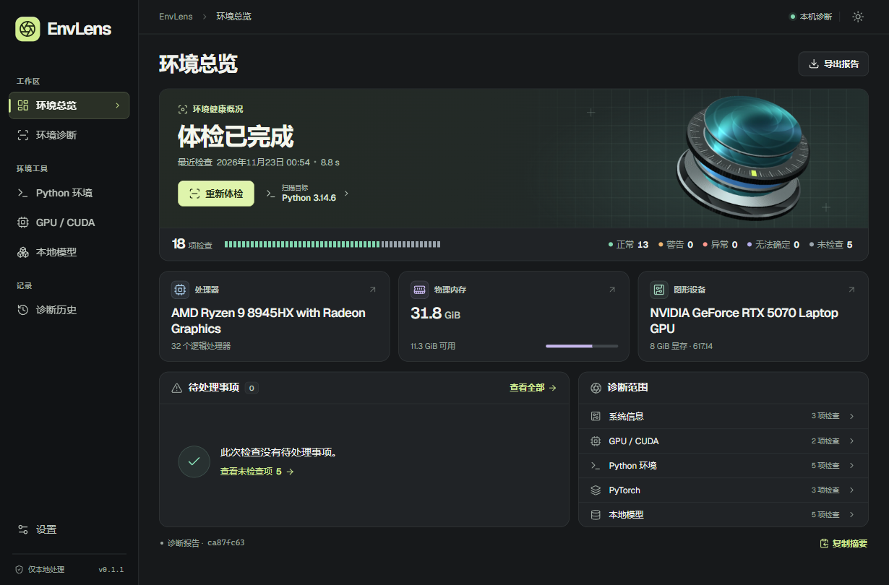

# EnvLens

[简体中文](README.md) · [User guide](docs/USAGE.md) · [Development and testing](docs/DEVELOPMENT.md)

EnvLens diagnoses local AI environments on Windows. Choose the Python executable your project actually starts, run a scan, then inspect the observations behind each finding. The desktop app and command-line scanner share the same Rust adapters and deterministic rules.



Select a status in the overview to filter checks, or open a hardware card to inspect its evidence. [Desktop interactions](docs/images/interactions.webp) · [Light appearance](docs/images/settings-light.png)

## Start a scan

1. Run the supplied `EnvLens_0.1.1_x64-setup.exe` as your current Windows user. The desktop uses the Microsoft Edge WebView2 Runtime. The default installer can fetch the runtime if it is missing.
2. Open **Python environments**. Choose a discovered interpreter, browse to a local `python.exe`, or select a project folder. Change the language in Settings if needed.
3. Choose **Run scan**. Open **GPU / CUDA** to inspect Windows adapter inventory, driver communication and the selected PyTorch runtime. Enable the optional one-element GPU test in Settings to verify computation.
4. Open a finding to see its evidence, impact, confidence and suggested steps. Run the scan again after making a change. Compare results in History or review a redacted export before sharing.

## Coverage

Windows version, CPU and memory come from native APIs and registry reads. The NVIDIA adapter queries device names, driver versions and VRAM. Python discovery covers PATH, Python Launcher, active venv/Conda prefixes, the Conda registry and conventional project-local locations. The selected interpreter provides package metadata, pip checks and PyTorch CUDA observations. Ollama reports CLI, process, service and model inventory separately.

Reports can be saved as Markdown, JSON or self-contained HTML. The latest twenty redacted reports are available locally. Diagnostic data stays on the machine. Ollama requests target loopback and require no API key.

A redacted real-machine example includes CUDA readback and an official local Ollama server with an empty model inventory. [Example JSON](docs/examples/windows-cuda.json) · [Verification record](docs/VERIFICATION.md)

## Build

Install the Windows C++ build tools with the Windows SDK, the stable Rust x64 MSVC toolchain, Node.js 24, pnpm 11 and WebView2.

```powershell
pnpm install --frozen-lockfile
pnpm desktop
pnpm bundle
```

The installer is written to `target/release/bundle/nsis/`. The CLI can be built with `cargo build --release -p envlens-core --bin envlens-scan --locked`. [Development instructions](docs/DEVELOPMENT.md)

## Scope

The initial target is Windows 10/11 x64. Installation and real CUDA computation were exercised on Windows 11 with an RTX 5070 Laptop GPU. A separate Windows 10 machine remains to be tested. WSL, containers, AMD/Intel acceleration and custom Ollama endpoints are outside this release. Python startup hooks are intentionally excluded from the probes. [Operating limits](docs/USAGE.md)

MIT licensed. EnvLens is a working title. An existing terminal environment-variable manager uses the same name, and trademark clearance is outstanding. [License](LICENSE) · [Existing project](https://github.com/craigf-svg/envlens) · [Contributing](CONTRIBUTING.md)
