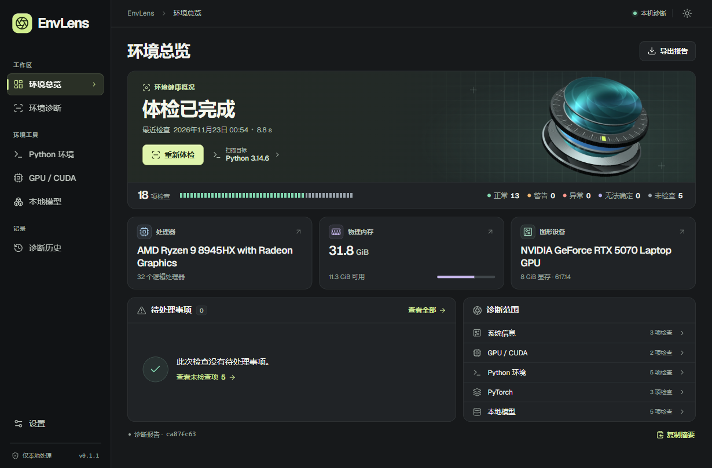
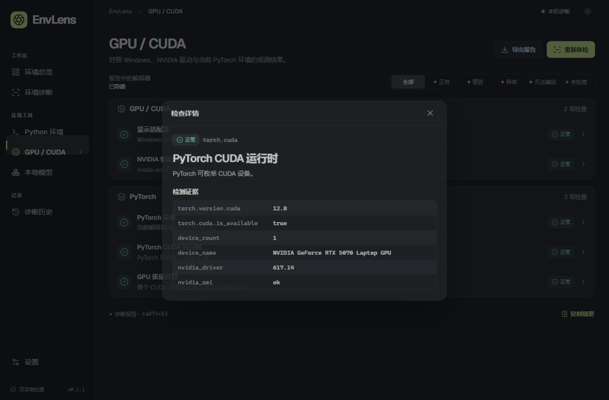

# EnvLens

[English](README.en.md) · [使用手册](docs/USAGE.zh-CN.md) · [开发与测试](docs/DEVELOPMENT.md)

EnvLens 是 Windows 上的本地 AI 环境诊断工具。选中项目实际使用的 Python，运行一次体检，就能看到 Windows、NVIDIA 驱动、PyTorch 和 Ollama 各自观察到了什么。展开检查项可以查看原始观测值、原因的置信程度、复检命令和官方资料。



点击总览里的状态可筛选检查项，点击硬件卡片可查看采样证据。[实机交互动效](docs/images/interactions.webp) · [浅色主题](docs/images/settings-light.png)

## 安装与首次体检

1. 在发行文件中打开 `EnvLens_0.1.1_x64-setup.exe`。安装范围为当前 Windows 用户。运行桌面程序需要 Microsoft Edge WebView2 Runtime。缺少该组件时，默认安装程序会尝试获取运行时。
2. 打开 **Python 环境**。可以从发现列表中选解释器，也可以选择本地 `python.exe` 或项目目录。便携版 ComfyUI 可以直接选它自带的解释器。
3. 点击 **开始体检**。在 **GPU / CUDA** 查看设备、驱动、PyTorch 构建和 CUDA 可用性。需要验证真实计算时，在 **设置** 启用单元素 GPU 验算，再运行一次。
4. 打开一项警告或异常，核对证据与处理步骤。手动处理后复检，在 **诊断历史** 比较两次结果。

诊断不需要 API Key。软件只对本机默认 Ollama 端口发起只读请求。复制摘要和历史归档默认脱敏，导出 Markdown、JSON 或 HTML 前可以逐项查看预览。

## 能诊断什么

| 范围 | 主要证据 |
| --- | --- |
| Windows | 系统版本、原生架构、CPU 型号与逻辑处理器数、总内存与可用内存、显示适配器 |
| NVIDIA | `nvidia-smi` 的可执行文件位置、GPU 名称、驱动版本、每张卡的显存 |
| Python | 启动器、PATH、活动环境、Conda 登记表及所选项目目录里的候选解释器，实际执行路径、前缀、pip、主要依赖版本与 `pip check` |
| PyTorch | 导入结果、构建版本、CUDA 可用性、设备数与名称、初始化错误类别、可选的单元素计算 |
| Ollama | CLI、进程、服务版本、模型清单和独立的推理状态 |



可以直接打开一份实机采集的脱敏 JSON，对照 GPU 构建、Ollama 版本和每项检查的证据。[示例报告](docs/examples/windows-cuda.json) · [验证记录](docs/VERIFICATION.md)

## 从源码运行

在 **EnvLens 项目根目录** 打开 PowerShell。需要 Rust stable MSVC x64、Visual Studio C++ 桌面开发工具与 Windows SDK、Node.js 24、pnpm 11 和 WebView2。

```powershell
pnpm install --frozen-lockfile
pnpm desktop
```

`pnpm bundle` 构建当前用户的 NSIS 安装程序，产物位于 `target/release/bundle/nsis/`。工程也提供 `scripts/windows.ps1 -Task dev`、`build` 和 `test` 入口。[环境准备及测试命令](docs/DEVELOPMENT.md)

## 适用范围与已知限制

首版面向 Windows 10/11 x64。已在 Windows 11 x64、RTX 5070 Laptop GPU 上验证安装及 CUDA 计算，Windows 10 独立实机验证待补。AMD/Intel 加速后端、WSL、容器和远程推理服务暂未覆盖。Ollama 检查默认回环地址，体检不会加载模型。Python 探针默认隔离项目启动代码，依赖自定义启动钩子的应用可能表现不同。[诊断规则与限制](docs/USAGE.zh-CN.md)

项目使用 MIT 许可证。EnvLens 为工作名，GitHub 已有同名的环境变量工具，本仓库尚未完成商标检索。[许可证](LICENSE) · [同名项目](https://github.com/craigf-svg/envlens) · [贡献指南](CONTRIBUTING.md)
